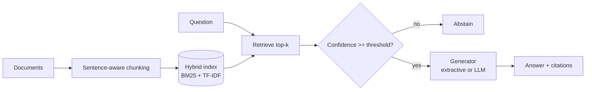

# Enterprise RAG Assistant

[](https://github.com/Shivanshi-svg/enterprise-rag-assistant/actions)

A retrieval-augmented question-answering service for internal knowledge bases. It answers
**only from indexed documents**, returns **citations**, and **abstains** when the knowledge base
does not contain the answer. Retrieval quality is measured, not assumed, and CI fails if it regresses.

> The sample corpus consists of short illustrative summaries of EU data-protection concepts written
> for this demo. It is not legal advice.

## Why this project

Most RAG demos stop at "it returns something". This one focuses on what matters in production:

- **Hybrid retrieval**: BM25 (exact terms, acronyms such as *DPIA*) plus TF-IDF cosine
  (semantic-ish overlap), merged with Reciprocal Rank Fusion so neither signal dominates.
- **Abstention**: a confidence threshold stops the service from guessing on out-of-scope questions.
- **Pluggable generation**: an offline extractive generator by default, or any OpenAI-compatible LLM
  via environment variables. If the LLM call fails, the service falls back to the extractive answer.
- **Evaluation harness**: recall@k and MRR over a labelled question set, run in CI.
- **Operational basics**: typed config, input validation, health check, non-root Docker image.

## Architecture



## Quick start

```bash
python -m venv .venv && source .venv/bin/activate
pip install -r requirements-dev.txt
pytest -q                               # unit + API tests
python -m rag_assistant.evaluation      # retrieval metrics
uvicorn rag_assistant.api:app --reload  # http://localhost:8000/docs
```

With Docker:

```bash
docker build -t rag-assistant .
docker run -p 8000:8000 rag-assistant
```

## API

| Method | Path | Purpose |
|---|---|---|
| GET | `/health` | Liveness and document count |
| GET | `/documents` | Indexed documents and chunk counts |
| PUT | `/documents/{id}` | Add or replace a document (`{"text": "..."}`) |
| DELETE | `/documents/{id}` | Remove a document |
| POST | `/query` | Ask a question (`{"question": "...", "top_k": 4}`) |

```bash
curl -s localhost:8000/query -H 'content-type: application/json' \
  -d '{"question": "Within how many hours must a breach be reported?"}'
```

## Using an LLM

Copy `.env.example` to `.env`, set `RAG_LLM_BASE_URL`, `RAG_LLM_API_KEY` and `RAG_LLM_MODEL`
(any OpenAI-compatible `/chat/completions` endpoint) and export them. Never commit `.env`.

## Evaluation and honest limitations

`data/eval_set.json` holds 10 labelled questions. On the sample corpus the current result is
recall@4 = 1.0 and MRR = 1.0. **This is a small, hand-written set and the corpus is tiny**, so
treat it as a regression guard rather than a benchmark. Known limitations:

- The index is rebuilt on every ingest (fine for thousands of chunks, not millions).
- Lexical and TF-IDF signals do not capture true semantic similarity. A natural next step is an
  embedding model plus a vector store such as pgvector, behind the existing `HybridRetriever` interface.
- No authentication or multi-tenancy yet.

## Project layout

```
rag_assistant/   chunking, retrieval, generation, pipeline, api, evaluation
data/            sample corpus and labelled evaluation set
tests/           pytest suite (chunking, retrieval, pipeline, API, evaluation)
```

## Roadmap

- [ ] Embedding-based dense retrieval and a cross-encoder reranker
- [ ] Persistent vector store (pgvector)
- [ ] API-key authentication and per-tenant indexes
